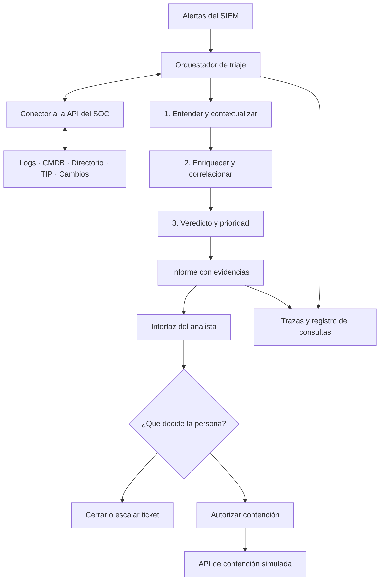

# Hack-2026-27 | Agentic SOC para Tarvia Group

> **UAB Hackathon 2026 · Reto Deloitte: IA para ciberseguridad**  
> **Estado del proyecto:** especificación inicial. La aplicación todavía no está implementada.

## TL;DR

Construiremos un sistema de **triaje de alertas de ciberseguridad asistido por agentes de IA** para el Security Operations Center (SOC) de la empresa ficticia Tarvia Group.

Por cada alerta, el sistema consultará las fuentes disponibles, reunirá evidencias, correlacionará actividad, determinará un veredicto, calculará la prioridad según la política del SOC y propondrá qué hacer. El analista verá **qué ha investigado la IA, en qué datos se basa y qué decisión recomienda**.

El objetivo del reto es atender alertas **24/7** con una investigación consistente y auditable. **Las decisiones sensibles y cualquier contención requieren aprobación humana**.

---

## 1. El problema

Tarvia Group se prepara para Black Friday. Su SOC recibe unas **400 alertas diarias**, cuenta con **3 analistas N1 y 2 N2**, y opera de **lunes a viernes, de 08:00 a 20:00**. Parte del trabajo de nivel 1 consiste en consultar varias herramientas, copiar indicadores, buscar actividad relacionada, documentar un ticket y decidir si cerrar o escalar.

En el escenario presentado por Deloitte, una alerta sencilla requiere aproximadamente **15 minutos** de triaje manual. El equipo no llega a investigar todo el volumen de alertas y deja periodos sin cobertura humana.

**La petición de la CISO:** desarrollar un piloto en el que agentes de IA realicen la investigación preliminar las 24 horas y el analista conserve la decisión final.

### Qué queremos conseguir

- Reducir el tiempo dedicado a recopilar contexto y evidencias por alerta.
- Clasificar correctamente amenazas reales, actividad legítima y falsos positivos.
- Priorizar según el riesgo del activo y la política de Tarvia, no solo según la severidad de la regla SIEM.
- Explicar cada veredicto mediante datos verificables.
- Facilitar que una persona confirme, corrija, escale o autorice la acción propuesta.

## 2. Contexto de negocio

| Dato | Tarvia Group |
| --- | --- |
| Sector | Moda y hogar |
| Empleados | 2.100 |
| Tiendas físicas | 64 |
| Negocio online | 38 % |
| Clientes | 1,3 millones |
| Operaciones relevantes | E-commerce, logística automatizada y asistente de compras con IA |
| SOC | 3 analistas N1 + 2 N2 |
| Horario actual | Lunes a viernes, 08:00–20:00 |
| Alertas habituales | ~400/día |
| Fuentes de logs | 18 |

### Activos y criticidad

La solución debe consultar la matriz oficial de criticidad y severidad proporcionada por el reto. La siguiente tabla resume el contexto de la presentación:

| Activo | Motivo | Criticidad |
| --- | --- | --- |
| Tienda online y app | 120.000 € por hora de caída | Crítica |
| CRM y copias de seguridad | Una brecha puede requerir notificación en 72 h | Crítica |
| Identidad (AD e IdP) | Permite acceder al resto del entorno | Crítica |
| Cobros online | PCI DSS y continuidad de las ventas | Crítica |
| Clasificador logístico | Su parada impide despachar pedidos | Alta |
| Asistente de IA «Vela» | Accede a pedidos de clientes | Alta |
| Puestos de trabajo | Vector de entrada habitual | Media |

## 3. Datos y herramientas del reto

Deloitte proporciona un **entorno ficticio**, con cuatro semanas de actividad. Los datos pueden contener alertas duplicadas, reglas mal ajustadas y acciones legítimas que se parecen a ataques. Las pistas pueden estar fuera de la alerta original.

| Recurso | Volumen o contenido |
| --- | --- |
| Alertas SIEM | **11.061** |
| Eventos | **814.471**, procedentes de 18 fuentes |
| Casos de uso de detección | **44** |
| Activos | **1.185** |
| Identidades | **1.224** |
| Contexto | Ficha de empresa, política SOC, matriz de severidad, SLA, 9 runbooks y esquema de ticket |
| Inventario | CMDB, directorio, servicios, red, vulnerabilidades, RR. HH. y calendario de cambios |
| Inteligencia | TIP interno, GeoIP, ASN, sandbox, logs de Active Directory y CI/CD |
| Integración | API del SOC para consultar datos y solicitar contención **simulada** |

**Importante:** el esquema real de la API, sus endpoints, credenciales y límites deben verificarse al recibir la documentación técnica. Este README no presupone que ya tengamos acceso ni que las integraciones funcionen.

## 4. Cómo debe investigar una alerta

Reproduciremos el proceso de triaje exigido por la política del SOC:

| Paso | Etapa | Qué hace el sistema |
| --- | --- | --- |
| 01 | **Entender** | Identifica qué regla ha saltado, qué detectó y a qué IP, usuario, host, proceso o dominio afecta. |
| 02 | **Contextualizar** | Consulta criticidad del activo, rol del usuario, inventario, cambios autorizados y otros datos de negocio. |
| 03 | **Enriquecer** | Obtiene reputación e inteligencia de indicadores mediante TIP, OSINT/GeoIP/ASN o sandbox cuando estén disponibles. |
| 04 | **Correlacionar** | Busca eventos y alertas relacionados para reconstruir lo sucedido. |
| 05 | **Decidir** | Emite un veredicto fundamentado y un nivel de confianza; si faltan pruebas, solicita revisión. |
| 06 | **Priorizar** | Aplica la matriz de severidad y criticidad, con los SLA y reglas oficiales del caso. |
| 07 | **Actuar** | Genera o actualiza el ticket, recomienda cierre/escalado y solicita aprobación para contención simulada cuando proceda. |

### Veredictos que debemos distinguir

- **True positive (TP):** actividad maliciosa real que requiere tratamiento como incidente.
- **Benign true positive (BTP):** la detección es correcta, pero la actividad está autorizada o es legítima.
- **False positive (FP):** la regla ha identificado erróneamente actividad sospechosa; no hay la condición que pretendía detectar.

Un resultado con pruebas insuficientes **no debe transformarse en una clasificación inventada**: la alerta queda pendiente de revisión humana y el sistema explica qué información falta.

## 5. Arquitectura propuesta

Para la hackathon conviene construir un **orquestador central con herramientas especializadas**, no siete agentes independientes que intercambian mensajes sin control. Los siete pasos son responsabilidades lógicas; podemos ejecutarlos mediante funciones deterministas y llamadas al modelo solo donde aporten valor.



### Componentes previstos

1. **Conector del SOC:** encapsula autenticación, consultas, paginación, errores y límites de la API facilitada por Deloitte.
2. **Motor de triaje:** coordina los siete pasos, aplica runbooks y registra el estado de cada alerta.
3. **Herramientas de investigación:** consultas tipadas para recuperar entidades, reputación, eventos, inventario y cambios. El modelo no debe inventar datos de las herramientas.
4. **Motor de decisión:** combina evidencias con reglas de negocio; las matrices de severidad, permisos y SLA deben aplicarse mediante lógica verificable.
5. **Registro de evidencias:** conserva las consultas, hallazgos, referencias y motivos que sustentan cada recomendación.
6. **Dashboard:** permite seguir la cola, abrir un expediente, revisar los pasos del agente y tomar decisiones humanas.
7. **Acciones del SOC:** crea tickets y ejecuta **únicamente** las operaciones simuladas permitidas, respetando el token de aprobación humana.

La elección de lenguaje, framework, base de datos, proveedor LLM y despliegue sigue **pendiente**. Antes de escogerlos debemos ver el contrato de la API y los recursos disponibles en la hackathon.

## 6. Contrato lógico de salida

Cada investigación debe producir un resultado estructurado y consumible por la interfaz. Ejemplo **orientativo**, no esquema oficial de Deloitte:

```json
{
  "alert_id": "ID_DE_LA_ALERTA",
  "verdict": "true_positive",
  "confidence": 0.91,
  "severity": "critical",
  "summary": "Resumen basado en lo observado",
  "affected_entities": ["HOST_O_USUARIO"],
  "evidence": [
    {
      "source": "soc_api",
      "reference": "ID_DEL_EVENTO",
      "finding": "Hallazgo respaldado por ese evento"
    }
  ],
  "recommended_action": "escalate",
  "requires_human_approval": true,
  "status": "pending_human_review"
}
```

Los valores de este JSON son ilustrativos. En la implementación definiremos tipos y validaciones, trazabilidad de las evidencias y tratamiento explícito de errores o campos desconocidos.

## 7. Qué verá el jurado

El domingo debemos presentar **una demostración en directo y visual**, sobre **las mismas 10 alertas que reciben todos los equipos**.

La interfaz debería mostrar:

1. **Cola de alertas:** estado, prioridad y progreso del triaje.
2. **Investigación de una alerta:** qué consultó el agente, qué encontró y por qué importa.
3. **Resultado explicable:** veredicto TP/BTP/FP, confianza, severidad, evidencias y recomendación.
4. **Control humano:** aceptar, corregir o escalar; aprobar expresamente la contención simulada.
5. **Vista de resultados:** alertas procesadas, tiempos observados y un resumen ejecutivo de una página para Tarvia.

### Qué se valorará

Según las diapositivas del reto:

- Triaje **correcto y bien argumentado**.
- Funcionamiento **real con los datos entregados**.
- Separación clara entre las tareas de la IA y la decisión humana.
- Honestidad respecto a lo que funciona, lo que falla y lo que todavía no se ha construido.

El propio reto indica que **un nivel 1 sólido y demostrable tiene más valor que aparentar un nivel 4 que no funciona**.

## 8. MVP para las 24 horas

Priorizamos una **vertical completa**, de alerta a decisión humana, antes de añadir funciones secundarias.

### P0 — Imprescindible

- [ ] Obtener la documentación de la API y probar una consulta real contra el entorno simulado.
- [ ] Leer las alertas y recuperar sus entidades y eventos relacionados.
- [ ] Aplicar los siete pasos del runbook a **una alerta de principio a fin**.
- [ ] Emitir un veredicto trazable y calcular la prioridad con la matriz del caso.
- [ ] Mostrar el expediente y la recomendación en una interfaz mínima.
- [ ] Extender el flujo a las **10 alertas de la demo**, sin inventar resultados.
- [ ] Mantener la aprobación humana en las acciones sensibles.

### P1 — Si la vertical ya funciona

- [ ] Procesamiento en cola, estados y reintentos controlados.
- [ ] Enriquecimiento cruzado y correlación entre varias alertas.
- [ ] Comparación visible de resultados, tiempos y decisiones.
- [ ] Generación de tickets y resumen ejecutivo.

### P2 — Solo si sobra tiempo

- [ ] Visualización avanzada de relaciones entre entidades.
- [ ] Ejecución concurrente y optimización de coste/latencia del modelo.
- [ ] Análisis agregado de las cuatro semanas completas.

**Orden recomendado:** API y datos → una alerta verificable → clasificación y prioridad → interfaz → las 10 alertas → ensayar demo. La parte visual no debe ocultar si las consultas o los veredictos fallan.

## 9. Criterios de aceptación y pruebas

Consideraremos que el MVP está listo para demostrar cuando:

- [ ] Las 10 alertas asignadas pueden cargarse y procesarse con identificadores correctos.
- [ ] Cada conclusión referencia datos recuperados del entorno, no suposiciones del modelo.
- [ ] La IA distingue TP, BTP y FP de acuerdo con las evidencias disponibles.
- [ ] La prioridad respeta la matriz y los SLA entregados por Deloitte.
- [ ] Los fallos de API, respuestas vacías y datos contradictorios quedan visibles y no generan un cierre automático injustificado.
- [ ] Una petición de contención **no se ejecuta** sin aprobación humana y token válido.
- [ ] La demo muestra el proceso completo en directo y reconoce los casos no resueltos.

Las métricas de tiempo, acierto, cobertura y coste se calcularán **sobre ejecuciones medidas**. No afirmaremos porcentajes de mejora sin una comparación reproducible.

## 10. Seguridad y límites

El ejercicio utiliza **datos y sistemas ficticios**. No está autorizado probar ataques contra infraestructura real ni ejecutar contenciones reales.

- Tratar los logs, alertas y resultados externos como **datos no confiables**: pueden contener texto de inyección de instrucciones.
- Dar a los agentes acceso de **solo lectura por defecto** y restringir cada herramienta a su función.
- Solicitar consentimiento humano explícito para una operación de contención.
- No guardar tokens, credenciales, claves de modelos ni datos sensibles en Git.
- Validar entradas y salidas de herramientas; registrar errores, fuentes e incertidumbre.
- Aplicar las políticas y permisos que entregue Deloitte en lugar de inventar reglas operativas.

## 11. Organización prevista del repositorio

Estructura **propuesta, todavía no creada**:

```text
Hack-2026-27/
├── README.md
├── frontend/             # Dashboard y revisión humana
├── backend/
│   ├── integrations/     # Cliente de la API del SOC
│   ├── triage/           # Orquestación e investigación
│   ├── policies/         # Runbooks, severidad y autorización
│   └── models/           # Contratos y validaciones
├── tests/                # Fixtures y pruebas de las alertas
├── docs/                 # Contrato de API y decisiones técnicas
└── .env.example          # Nombres de variables, nunca secretos
```

No hay comandos de instalación ni de ejecución todavía porque **no se ha elegido ni implementado un stack**. Cuando exista la primera vertical, esta sección recogerá comandos reales y comprobados para instalar dependencias, configurar el entorno y ejecutar la demo.

## 12. Primeras decisiones pendientes

- [ ] Revisar documentación, datos de ejemplo y autenticación de la API de Deloitte.
- [ ] Identificar los campos de alerta, activos, identidades, logs y tickets.
- [ ] Elegir un stack que el equipo domine y pueda ejecutar localmente durante la demo.
- [ ] Decidir el proveedor/modelo LLM y sus límites de uso.
- [ ] Definir el contrato exacto de respuesta del motor de triaje.
- [ ] Confirmar formato, mecanismo de aprobación y restricciones de la API de contención.
- [ ] Repartir responsabilidades entre integración, triaje, frontend y pruebas.

---

## Referencia del reto

README elaborado a partir de las diapositivas del **reto de Deloitte en la UAB Hackathon 2026** compartidas por el equipo. Tarvia Group y su infraestructura son un **caso ficticio** del ejercicio.

Este documento recoge **requisitos del reto** y una **propuesta inicial de implementación**. Actualizaremos las secciones técnicas conforme comprobemos el funcionamiento de la API y construyamos el proyecto.
