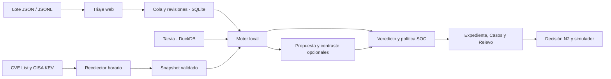

# Arquitectura de Vigía

Vigía investiga alertas del SIEM de Tarvia, documenta lo que puede verificar y deja las decisiones críticas al SOC. El mismo motor de Python atiende la web y el escritorio. La web es la interfaz para la defensa.

## Entrada, estado e investigación

- **Importación.** La web admite hasta 150 alertas y 1 MB. Un ID oficial se resuelve desde el índice y una alerta nueva requiere un objeto válido. La cola persiste el estado y el ID de cada alerta. Se procesa primero la severidad declarada más alta y el lote conserva el orden de entrada en sus resultados.
- **Evidencia.** DuckDB contiene el dataset indexado de solo lectura. El motor busca referencias originales, inventario, cambios aprobados, reputación y actividad relacionada. Las reglas comprueban vínculos concretos por entidad, tiempo o indicador. Los registros relacionados se conservan como contexto mientras no exista prueba de una relación causal.
- **Contraste.** Si se activa, Luna propone un veredicto y revisa casos ordinarios. Sol contrasta los graves, las abstenciones, la baja confianza y las discrepancias. Ambos reciben la Guía general, el runbook, sus revisiones vigentes y la misma inteligencia de vulnerabilidades relevante. Las citas deben apuntar a evidencia recuperada. El motor mantiene la decisión local cuando el contraste discrepa o carece de respaldo.
- **Tolerancia a fallos.** Si en la fase de propuesta falla la conexión, la cuenta o la disponibilidad del modelo, se suspenden las llamadas restantes de ese lote. Vigía completa los informes con la evidencia local y marca el contraste omitido. La petición sigue registrada como remota a efectos de autocierre. Un lote nuevo vuelve a intentar la conexión.
- **Persistencia.** SQLite guarda decisiones, revisiones de guías, informes y estado de triaje. Casos y Relevo agrupan miembros con el mismo incidente acreditado. Triaje, búsqueda, expediente e historial conservan las decisiones de cada alerta. Los expedientes ya cerrados con decisión vigente se reutilizan al repetir la entrada.

## Política, cronología e inteligencia

Las reglas locales aplican la matriz de severidad y el SLA de Tarvia. Toda crítica se escala de inmediato. Las altas se escalan a N2 en la misma jornada, también cuando faltan datos para clasificar. Los cierres automáticos de alertas nuevas quedan restringidos a perfiles de bajo riesgo con todas sus referencias directas corroboradas. El único recorrido de contención implementado opera sobre el simulador del reto y requiere confirmación y reautenticación N2. [Política del SOC](https://github.com/dttdfr/DTT-UAB-The-Hack/blob/5d7569232756eaf0a8723b22c428b70e8f67824f/01_contexto/politica_soc.md)

La cronología separa alertas del sensor, hallazgos y registros de contexto. Las fases de ataque del caso proceden del informe N2 acreditado. El tipo de registro por sí solo no establece una táctica. La exportación conserva el criterio, el origen de las citas y la decisión vigente. [Tácticas de MITRE ATT&CK](https://attack.mitre.org/tactics/enterprise/)

El perfil opcional `inteligencia` de Compose actualiza CISA KEV y los deltas de la lista oficial de CVE cada hora. El recolector valida campos y tamaños, escribe un snapshot atómico y conserva la última copia válida por fuente. La web lo abre en solo lectura. Se cruzan IDs CVE con el inventario local. En una alerta externa se exige además un registro original contemporáneo que vincule el equipo con la alerta. La inteligencia informa sobre exposición posible, lleva fuente y fecha y nunca activa por sí sola un cierre ni una acción. Las guías se editan por separado y conservan su historial. [Fuentes, límites y operación](arquitectura-inteligencia.md)

## Qué tomamos del sector

- **Vulnerabilidades por inventario.** Wazuh cruza las versiones observadas con fuentes de vulnerabilidades. En Tarvia partimos de los CVE que ya registra el inventario. Para detectar exposición de productos recién incorporados harían falta versiones o un SBOM. [Wazuh Vulnerability Detection](https://documentation.wazuh.com/current/user-manual/capabilities/vulnerability-detection/how-it-works.html)
- **Respuesta operativa.** La prioridad, el responsable y el plazo aparecen juntos en el informe. El analista puede dedicar la revisión a incidentes que necesitan una decisión. [NIST SP 800-61 Rev. 3](https://csrc.nist.gov/pubs/sp/800/61/r3/final)
- **Entradas no confiables.** Los textos del SIEM, los eventos y los avisos públicos son datos. Las verificaciones de evidencia y los permisos viven en código. Los modelos redactan propuestas y contrastes sin acceso a acciones de contención. [OWASP LLM01](https://genai.owasp.org/llmrisk/llm01-prompt-injection/)

## Verificación y defensa

El barrido offline de Tarvia generó 11.061 expedientes sin errores en 121,39 s con cuatro trabajadores en Docker. La mediana fue de 35 ms y el p95 de 103 ms por alerta. Hubo 8.806 cierres elegibles, 281 escalados y 1.237 abstenciones. Son medidas de cobertura y latencia local. El lote inédito del jurado permitirá comprobar el comportamiento ante sus diez casos.

Las regresiones cubren importación, autocierre, citas, escalado, agrupación de incidentes, snapshot y cronología. Una caída simulada del proveedor produjo cuatro expedientes con una sola llamada y mantuvo los tres escalados. El recolector también se probó contra ambas fuentes oficiales desde Docker. [Guion de defensa](defensa-web.md) · [Una página para el comité](comite-tarvia.md)

La consola usa Open Sans, verde Deloitte para el acento y JetBrains Mono para identificadores y registros. Las fuentes se sirven con la aplicación. El pase de Unslop redujo ornamentos, contenedores y etiquetas repetidas en favor de las decisiones y sus pruebas. [Identidad visual de Deloitte](https://www.deloitte.com/fr/fr/about/story/logo.html) · [Unslop de Damir Sokolovsky](https://github.com/heydamir/unslop)
